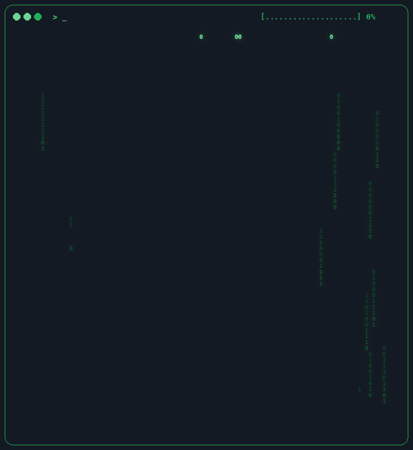

  

  

  
  
  

<!-- ═══════════ YO, CONSTRUIDO EN BINARIO + TERMINAL ═══════════ -->

  
  

<!-- ═══════════ HABILIDADES ═══════════ -->
<h2 align="center">⚡ 𝚂𝚝𝚊𝚌𝚔 𝚎𝚗 𝚘́𝚛𝚋𝚒𝚝𝚊</h2>

  

  

<!-- ═══════════ COMMITS EN VIVO ═══════════ -->
<h2 align="center">🚀 𝙲𝚘𝚖𝚖𝚒𝚝𝚜 𝚎𝚗 𝚟𝚒𝚟𝚘</h2>

  
  

  

  

<!-- Ciudad 3D de commits (la genera la Action "3D") -->

  

<!-- Viborita comiéndose los commits (la genera la Action "Snake") -->

  <picture>
    <source media="(prefers-color-scheme: dark)" srcset="https://raw.githubusercontent.com/N00385644/N00385644/output/snake-dark.svg" />
    <source media="(prefers-color-scheme: light)" srcset="https://raw.githubusercontent.com/N00385644/N00385644/output/snake.svg" />
    
  </picture>

<h2 align="center">🏆 𝚃𝚛𝚘𝚏𝚎𝚘𝚜</h2>

  

